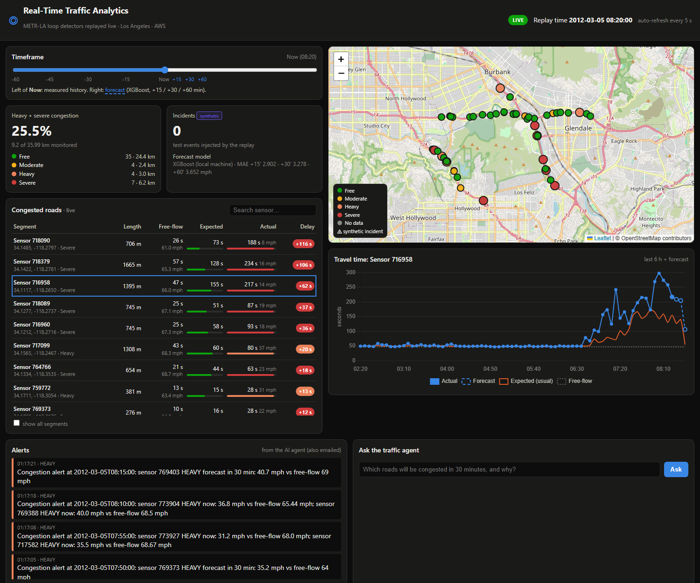

# Real-Time Traffic Analytics & Congestion Prediction on AWS

A cloud platform that collects traffic data, measures road congestion live, predicts it
15, 30 and 60 minutes ahead with XGBoost, sends alerts and reports through an AI agent, and
shows everything on a web dashboard.

Students: Khalil Hedhili, Aziz Karray · Supervisor: Mme Asma Ben Letaifa



## Quick start

You need: Python 3.11+, the [AWS SAM CLI](https://docs.aws.amazon.com/serverless-application-model/latest/developerguide/install-sam-cli.html)
(`winget install Amazon.SAM-CLI`), and either Python 3.11 (`winget install Python.Python.3.11`)
or Docker Desktop running (SAM builds the Lambdas in Docker when there is no 3.11).

```powershell
cd traffic-analytics-aws
python tasks.py setup                  # .venv + dependencies + .env (set ALERT_EMAIL in .env)
# put your AWS credentials in %USERPROFILE%\.aws\credentials
#   (Learner Lab: Start Lab > AWS Details > AWS CLI > copy the [default] block)
python tasks.py check --probe-write    # what the account allows -> deployment choices
python tasks.py deploy                 # stack + data + model + dashboard (about 10-15 min the first time)
python tasks.py demo                   # fast replay (1 tick / 10 s) and opens the dashboard
```

With GNU make the same targets work as `make setup`, `make deploy`, `make demo`, ...
(`make check ARGS=--probe-write`). Finish every session with:

```powershell
python tasks.py destroy                # removes every billable resource (asks for the stack name)
```

No AWS account at hand? `python tasks.py local` runs the whole pipeline on this machine
(AWS mocked with moto) and serves the dashboard on http://localhost:8080.

## Architecture

```
1 METR-LA replay ─► 2 EventBridge + producer Lambda ─► 3 Kinesis ─► 4 congestion Lambda ─► 5 DynamoDB ─┐
                                                          │                  │ alert events             │
                                                          ▼                  ▼                          ▼
                                                   6 Firehose ─► 7 S3 + Glue + Athena    9 AI agent (Bedrock      10 API Gateway
                                                                          │              + LangChain) ─► SNS        + dashboard
                                                                          ▼                    ▲
                                                                   8 SageMaker XGBoost ────────┘ forecasts -> DynamoDB
```

| # | Block | Service | Code |
|---|-------|---------|------|
| 1 | METR-LA replay (real-API interface ready) | S3 `replay/` | `common/traffic_common/replay.py` |
| 2 | Scheduled producer | EventBridge rule or Scheduler + Lambda | `producer/app.py` |
| 3 | Streaming ingestion | Kinesis Data Streams (on-demand) | `infra/template.yaml` |
| 4 | Congestion + alert events | Lambda (Kinesis trigger) | `processing/app.py`, `common/traffic_common/congestion.py` |
| 5 | Latest values | DynamoDB `traffic_latest`, `forecasts`, `sensor_meta` (+ `traffic_history`, `app_state`) | `common/traffic_common/store.py` |
| 6 | Raw archive | Data Firehose → S3 `raw/dt=/hour=` | `infra/template.yaml` |
| 7 | Data lake, ETL, SQL | S3 + Glue crawler + Glue ETL (PySpark) + Athena | `glue/etl_job.py`, `glue/athena/*.sql` |
| 8 | Forecast +15/+30/+60 | SageMaker training (+ Serverless endpoint) + forecast Lambda | `ml/` |
| 9 | Alerts, daily report, chat | Bedrock + LangChain in Lambda, SNS email | `agent/` |
| 10 | Dashboard | S3 static site (+ CloudFront), API Gateway HTTP API + Lambda | `dashboard/`, `api/app.py` |

Details and every design decision: [docs/architecture.md](docs/architecture.md). Data
formats: [docs/data_dictionary.md](docs/data_dictionary.md).

## Results

XGBoost beats both baselines at every horizon on the chronological test split
(full table in [docs/results.md](docs/results.md)):

| Horizon | Last value MAE | Historical average MAE | **XGBoost MAE** |
|---|---|---|---|
| +15 min | 3.41 mph | 3.97 mph | **2.90 mph** |
| +30 min | 4.08 mph | 3.97 mph | **3.28 mph** |
| +60 min | 5.22 mph | 3.97 mph | **3.65 mph** |

## Commands

| Command | What it does |
|---|---|
| `setup` | create `.venv`, install dependencies, create `.env` |
| `check [--probe-write]` | probe every service, pick fallbacks, write `.access_report.json` |
| `download` | METR-LA into `data/` (verified: 34272 × 207) |
| `eda` | free-flow speeds, expected-time profiles, replay files, `training.npz`; runs `ml/notebooks/EDA.ipynb` |
| `train [--where local\|sagemaker\|auto] [--endpoint]` | baselines + XGBoost, `docs/results.md`, publishes the model |
| `local` | full pipeline + dashboard on this machine, no AWS |
| `deploy` | SAM build/deploy, seed DynamoDB/S3 (incl. 4-month Parquet backfill), model, dashboard, Athena queries |
| `demo [seconds]` | replay from Monday 06:00 at 1 tick / 10 s (morning rush in ~2 minutes), open the dashboard |
| `pause` | disable the producer and forecast schedules |
| `etl` | run the Glue crawler and ETL job now |
| `ask "question"` | ask the deployed agent; prints the answer and its tool calls |
| `report` | generate the daily report now (S3 `reports/` + email) |
| `status` | URLs and current mode |
| `destroy` | delete endpoints, empty buckets, delete the stack and log groups, list leftovers |
| `test` / `lint` / `validate` | pytest (61 tests) / ruff / cfn-lint + sam validate |

## Configuration

Everything is an environment variable (see [.env.example](.env.example)), read by
`common/traffic_common/config.py`: `N_SENSORS` (50, up to 207), `TICK_SECONDS`,
`REPLAY_MODE` (`clock` or `cursor`), `LEVEL_MODERATE/HEAVY/SEVERE` (0.2/0.4/0.6),
`FREEFLOW_PERCENTILE` (85), `FORECAST_HORIZONS` (15,30,60), `ALERT_EMAIL`,
`ALERT_DEDUP_MINUTES` (30), `LLM_PROVIDER`, `BEDROCK_MODEL_ID`, `USE_CLOUDFRONT`.
Changing `N_SENSORS` needs `eda` + `train` + `deploy` again (the model is trained for the
selected sensors).

**If Bedrock is blocked** (common in Learner Lab): store an Anthropic or OpenAI key in
Secrets Manager and set `LLM_API_KEY_SECRET_NAME` (and `LLM_PROVIDER=anthropic|openai`) in
`.env`, then `deploy`. Without any LLM the agent still answers from real tool calls with
fixed wording, and alerts use a template.

## Costs (us-east-1, approximate)

| Item | Real time (tick 5 min) | Demo (tick 10 s) |
|---|---|---|
| Kinesis on-demand stream | ~$0.04 / h (≈ $1 / day) | same |
| Lambda (producer, processor, forecast, API, agent) | < $0.05 / day | ~$0.08 / h |
| DynamoDB on-demand | ~$0.02 / day | ~$0.10 / h |
| Firehose, S3, API Gateway, SNS, CloudWatch | < $0.05 / day | < $0.02 / h |
| Glue crawler + ETL (daily, 2 × G.1X) | ~$0.10 / run | – |
| SageMaker training (ml.m5.large, ~10 min) | ~$0.02 per training | – |
| Serverless endpoint (if enabled) | per request, ~$0.01 / day | ~$0.05 / h |
| Bedrock (Claude Haiku class, alerts + chat) | cents per day | cents per hour |
| **Total** | **≈ $1.3 / day** | **≈ $0.3 / h** |

`pause` stops the per-tick costs but the Kinesis stream keeps billing: run `destroy` when you stop working.

## Troubleshooting

- **`ExpiredToken`**: Learner Lab credentials last about 4 h; copy fresh ones and rerun.
- **`sam build` fails on Windows**: install Python 3.11, or start Docker Desktop.
- **Dashboard shows "API error"**: open the browser console; the API URL is in
  `config.js` (written by `deploy`). The S3 website needs public access; if the account
  blocks it, set `USE_CLOUDFRONT=true` (if allowed) or open `dashboard/index.html`
  locally after copying `dashboard/config.local.js` over `dashboard/config.js`.
- **No alert email**: confirm the SNS subscription email first; alerts are de-duplicated
  for 30 min per segment.
- **Athena "no data"**: curated history is backfilled by `deploy`; streamed data reaches
  `curated/` after `python tasks.py etl` (or the daily trigger).

## Repository layout

```
infra/template.yaml   all AWS resources (SAM)          common/traffic_common/  shared code (Lambda layer)
producer/  processing/  ml/inference/  api/  agent/   one folder per Lambda
glue/      ETL job + Athena queries                    ml/  dataset, features, training, SageMaker entry, EDA
scripts/   check_access, download, precompute, seed, local_run, teardown
dashboard/ static site (Leaflet + Chart.js)            tests/  pytest     docs/  architecture, results, demo
```
