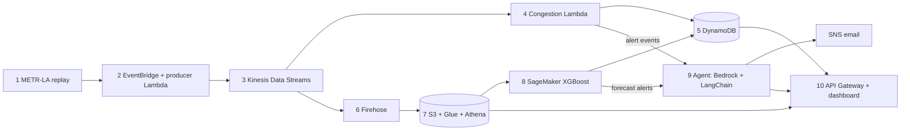

# Architecture and decisions

Real-Time Traffic Analytics & Congestion Prediction on AWS.
Students: Khalil Hedhili, Aziz Karray. Supervisor: Mme Asma Ben Letaifa.

## The 10 blocks

The numbering matches the slides and is used everywhere (template comments, folders, docs).

| # | Block | AWS service | Repo folder | Phase |
|---|-------|-------------|-------------|-------|
| 1 | Traffic data: METR-LA replay (interface ready for a real API) | n/a | `producer/` | 1–2 |
| 2 | Scheduled producer | EventBridge (rule or Scheduler) + Lambda | `producer/` | 2 |
| 3 | Streaming ingestion | Kinesis Data Streams (on-demand) | `infra/` | 2 |
| 4 | Congestion processor + alert events | Lambda (Kinesis trigger) | `processing/` | 2 |
| 5 | Latest state | DynamoDB `traffic_latest`, `forecasts`, `sensor_meta` (+ `traffic_history`, `app_state`) | `common/traffic_common/store.py`, `scripts/seed_dynamo.py` | 2 |
| 6 | Raw archive | Data Firehose → S3 `raw/` | `infra/` | 2 |
| 7 | Data lake, ETL, SQL | S3 + Glue crawler/ETL + Athena | `glue/` | 3 |
| 8 | Forecast 15/30/60 min | SageMaker training (+ Serverless endpoint) + scheduled forecast Lambda | `ml/` | 4 |
| 9 | AI agent: alerts, daily report, chat | Bedrock + LangChain in Lambda, SNS | `agent/` | 5 |
| 10 | Web dashboard | S3 static site (+CloudFront) + API Gateway + Lambda | `dashboard/`, `api/` | 6 |

## Shared code and configuration

- `common/traffic_common/` holds code used by more than one component: config, congestion
  formula, replay source, forecast features, pure-Python XGBoost evaluator, DynamoDB/S3
  access, Athena allow-list. It is deployed as a Lambda layer, so every
  Lambda uses the same formula and thresholds.
- `common/traffic_common/config.py::Settings` is the only place settings are read. Every value
  comes from an environment variable with a default; locally `.env` fills the environment,
  in AWS the SAM template sets the Lambda environment from stack parameters.

## Decisions log

Decisions made without asking, per the brief. Change any of them by editing this file and the
matching default.

| # | Topic | Decision | Why |
|---|-------|----------|-----|
| D1 | IaC | **AWS SAM** (one template, `infra/template.yaml`) | Python-only toolchain (CDK needs Node.js, not installed); SAM is CloudFormation, so `delete-stack` removes everything it created. |
| D2 | One-command deploy/destroy | `make deploy` / `make destroy` → `tasks.py` | `make` is not installed on this Windows machine; `tasks.py` holds the logic so `python tasks.py deploy` works the same without make. |
| D3 | IAM | No IAM resources in the stack. Every Function, Firehose, Glue job/crawler and SageMaker job sets `Role: !Ref LabRoleArn` | Learner Lab forbids creating roles. LabRole ARN is a parameter, default `arn:aws:iam::<account>:role/LabRole`. |
| D4 | Region | `us-east-1` | Brief default; Learner Lab only allows us-east-1 / us-west-2. |
| D5 | Scheduling (block 2) | EventBridge **rule** by default; EventBridge **Scheduler** only if `check_access.py --probe-write` proves Scheduler can pass LabRole | Rules invoke Lambda through a resource policy (no role); Scheduler needs PassRole, which Learner Lab may refuse. Template parameter `SchedulerType`. |
| D6 | Demo speed | `TICK_SECONDS` (300 = real time, 10 = demo). EventBridge's minimum period is 1 min, so in demo mode each producer invocation publishes `60 / TICK_SECONDS` slices, sleeping between them | Keeps one code path; no always-on server. |
| D7 | Replay mapping | `REPLAY_MODE=clock`: "now" maps to the dataset slot with the same weekday and time of day (so rush hour shows at rush hour); `cursor` mode starts at `REPLAY_START` and advances one slot per tick (best for demos) | Detailed in Phase 2. |
| D8 | Kinesis | On-demand stream | No shard sizing; ~$0.04/h while deployed. Switch to 1 provisioned shard if on-demand is denied. |
| D9 | Local mode | **moto** (in-process server, or `docker-compose.yml`) instead of LocalStack | Free, no account/token, no Docker needed; supports Kinesis, DynamoDB, S3, Firehose, SNS. Lambdas run as plain Python functions against it. Glue/Athena locally → DuckDB/pandas on local Parquet; SageMaker locally → the same XGBoost code run in-process; LLM locally → fake model. |
| D10 | Python | Lambdas target `python3.11`. Local dev venv may use a newer Python; `sam build` uses Docker (`--use-container`) when no 3.11 interpreter is found (`SAM_USE_CONTAINER=auto`) | Only Python 3.14 is installed here. Installing 3.11 (`winget install Python.Python.3.11`) avoids needing Docker for builds. |
| D11 | API Gateway | HTTP API (v2) | Cheaper and simpler than REST API; CORS built in. |
| D12 | Naming and tags | Every resource is tagged `Project=<PROJECT_NAME>`; out-of-stack resources (SageMaker endpoints/models/jobs) are named `<PROJECT_NAME>-…` | Lets `scripts/teardown.py` find and delete them, then list leftovers by tag. |
| D13 | LLM choice | `check_access.py` lists Bedrock models/inference profiles, tries Claude Haiku first (cheap, good at tool use), then other Claude, then Amazon Nova; stores the working id. If none works: `LLM_PROVIDER=anthropic` or `openai` with the key in Secrets Manager | Model availability in Learner Lab varies; no hard-coded model id. |
| D14 | Inference (block 8) | Serverless endpoint if allowed and its quota is > 0; else batch transform; else the XGBoost model loaded inside the forecast Lambda | Decided automatically by `check_access.py` (`decisions.inference`). |
| D15 | Frontend hosting | CloudFront in front of S3 if allowed, else S3 static website hosting | `decisions.frontend_cdn`. |
| D16 | Cost guard | Lifecycle rule expires `athena-results/` after 7 days; teardown deletes SageMaker endpoints first (main cost risk) | Learner Lab budget is limited. |
| D17 | Extra tables | `traffic_history` (PK sensor, SK ts, GSI `by_ts`, TTL 3 days) and `app_state` (replay cursor, alert de-duplication, alerts feed, forecast snapshots, active model) besides the three required tables | The chart needs the last hours per sensor and the slider needs every sensor at one past slot in milliseconds; Athena (seconds) stays for long-range history. One generic state table avoids SSM/extra services. |
| D18 | Alert events | Processor and forecast Lambda put `CongestionAlert` events on the default EventBridge bus; a rule invokes the agent | Decoupled, no role needed (resource policy), easy to add consumers. |
| D19 | One multi-horizon model | A single XGBoost model with `horizon` as a feature serves +15/+30/+60 | One artifact, one endpoint, one evaluation run; still beats both baselines at every horizon. |
| D20 | Inference default | The forecast Lambda evaluates the XGBoost JSON model in pure Python (`xgb_eval.py`, tested against xgboost); a SageMaker Serverless endpoint is used when training ran on SageMaker and the access report allows endpoints (`train --endpoint` forces it) | No numpy in Lambda, no endpoint cold start or idle cost; the endpoint path exists for the brief. `app_state[model/active]` switches mode without redeploying. |
| D21 | SageMaker training | Built-in XGBoost 1.7-1 container in script mode running the same `ml/train_core.py` as local training; input is the 3 MB `training.npz`, features are built inside the job | Same code, same metrics in both places; tiny upload. |
| D22 | Statistics without leakage | Free-flow speed, expected profile and the historical-average baseline use the training period only; chronological split 70/10/20; rows whose target crosses a split boundary are dropped | Honest test metrics. |
| D23 | Sensor selection | Sensors ranked by distance to the network centre; `N_SENSORS` takes a prefix (50 → compact area around Glendale / Hollywood) | Any N gives a contiguous map; neighbours exist inside the selection. |
| D24 | Replay time everywhere | All `ts` are dataset (2012) times; the dashboard labels them "Replay time" | Expected-time profile, features and history all line up; no fake dates. |
| D25 | Lake history | `deploy` backfills `curated/` with the full 4-month history (Parquet, same schema as the ETL), so Athena, the agent and the daily report work immediately; the Glue ETL appends streamed data (job bookmarks) | Otherwise history would be empty until days of streaming. |
| D26 | Demo / pause | `demo` redeploys with `TickSeconds=10`, `ReplayMode=cursor` and resets the cursor with 6 h of warm-up history; `pause` sets `ProducerState=DISABLED` | No drift between the stack and reality; the producer, forecast and dashboard refresh all read the same parameter. |
| D27 | LLM fallback | `LLM_PROVIDER=bedrock` uses `ChatBedrockConverse`; on access errors the agent switches to `ChatAnthropic`/`ChatOpenAI` if a key is in Secrets Manager; with no LLM the chat answers from the same tool calls with fixed wording | The definition of done (answers from real tool calls) holds in every account. Chat tools exclude `send_alert`, so a chat can never email operators. |
| D28 | Dashboard colours | Congestion levels use the status palette (good/warning/serious/critical), always paired with a text label; chart series use the categorical palette; dark mode follows the OS | Colour is never the only carrier of meaning. |

## AWS Academy Learner Lab notes

- Credentials (AWS Details → AWS CLI) expire after about 4 hours: paste fresh ones into
  `~/.aws/credentials` before each session. The checker reports `ExpiredToken` clearly.
- The checker detects Learner Lab from the `voclabs` role in the caller ARN.
- `sam deploy --resolve-s3` creates a shared `aws-sam-cli-managed-default` stack (artifact
  bucket). Teardown leaves it in place; it costs cents.
- Kinesis, Firehose and scheduled Lambdas keep running (and billing) after the lab session
  ends: run `make destroy` at the end of a working session, or at least stop the demo schedule.

## Not verified against a real AWS account yet

Everything was tested locally (61 tests, the full pipeline on moto, the SageMaker entry point
run locally). These parts can only be confirmed in the account: SAM build/deploy, the Glue
ETL job (PySpark), Athena queries, SageMaker training/endpoint, Bedrock model access, SNS
email, CloudFront. `check --probe-write` reports what is allowed before deploying.
