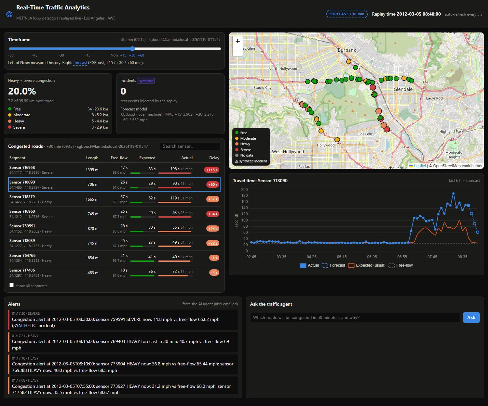

# Results

Forecast of speed (mph) on METR-LA, 50 sensors, chronological split 70/10/20 (train until 2012-05-23T07:05:00, test from 2012-06-04T04:45:00).
Model: XGBoost (178 trees, trained on 1,500,000 rows, where: local machine). MAPE ignores missing (zero) readings.

| Horizon | Method | MAE (mph) | RMSE (mph) | MAPE (%) | Rows |
|---|---|---|---|---|---|
| +15 min | Last value | 3.414 | 6.245 | 7.90 | 304,479 |
| +15 min | Historical average (same slot) | 3.968 | 7.551 | 12.07 | 304,479 |
| +15 min | **XGBoost** ✓ | 2.902 | 5.260 | 7.50 | 304,479 |
| +30 min | Last value | 4.084 | 7.860 | 9.92 | 304,479 |
| +30 min | Historical average (same slot) | 3.968 | 7.551 | 12.07 | 304,479 |
| +30 min | **XGBoost** ✓ | 3.278 | 6.178 | 9.09 | 304,479 |
| +60 min | Last value | 5.224 | 10.151 | 13.29 | 304,479 |
| +60 min | Historical average (same slot) | 3.969 | 7.551 | 12.07 | 304,479 |
| +60 min | **XGBoost** ✓ | 3.652 | 7.033 | 10.69 | 304,479 |

✓ = lowest MAE for that horizon.

XGBoost beats both baselines at +15 and +30 min: **yes**.

Most useful features (total gain share): `expected_target` 53%, `lag_0` 24%, `mean_3` 9%, `expected_now` 5%, `slot_cos` 2%, `horizon` 1%, `nbr_mean` 1%, `nbr_delta` 1%.

<!-- end of generated metrics -->

## Method

- Data: METR-LA, the 50 sensors closest to the network centre (`N_SENSORS`), zeros masked as missing.
- Split: chronological 70 / 10 / 20 % (train / early-stopping validation / test); statistics
  (free-flow, expected profile, historical average) from the training period only.
- Baselines: **last value** (latest observed speed) and **historical average** (mean speed of
  the same sensor, weekday and 5-minute slot in the training period).
- Model: one XGBoost regressor for all horizons (`horizon` is a feature), 28 features
  (one hour of lags, rolling statistics, neighbour speeds, time of day / week, expected speed
  at the target slot). Early stopping on validation MAE.
- Regenerate this table: `python tasks.py train` (local) or `python tasks.py train --where sagemaker`.

## Screenshots

Live view during the Monday morning rush (local mode, same code as AWS):

Timeline slider on **+30 min**: forecast badge, dashed map markers, forecast travel times in the table:

